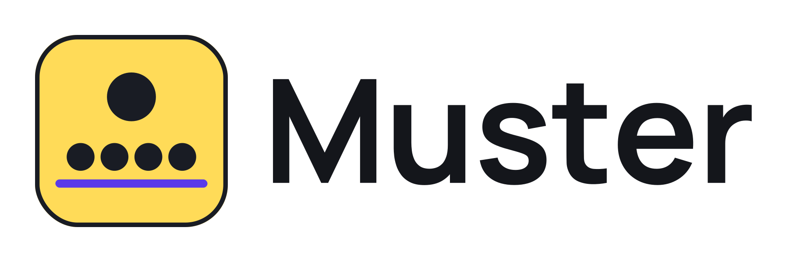

<p align="center">
  <picture>
    <source media="(prefers-color-scheme: dark)" srcset="assets/muster-lockup-dark.png">
    
  </picture>
</p>

# Muster: a crew of Claude Code chats

Muster turns Claude Code into a small crew: a squad of workers geared to finish tasks efficiently, with a very high eye
for detail and quality, while protecting your usage. Each worker is its own chat. You talk to one of them, the
manager; it hands the work out, and nobody checks their own work.

## The crew
| Worker | What it does |
|---|---|
| Manager_<your project> | Your go-between and record keeper. Sorts what you say into orders, questions and ideas, keeps your list, and only asks you one question at a time. Never builds. |
| Builder A_<your project> | Builds what you ask for. |
| Designer_<your project> | Builds what people see. |
| Inspector_<your project> | Checks the work, and checks the manager's record keeping. Never builds. |

Add-ons you can pick on the setup page: extra builders (Builder B_<your project> and up), Sketchpad_<your project> (for playing with
ideas), AI Socket_<your project> (for plugging in other AIs), and Agent Teacher_<your project> (train your own agent in Claude Console).
When three or more workers build, a second inspector, Design Inspector_<your project>, joins to check what people see.

## Install
**In the Claude desktop app:** open the Code tab, start a chat, and send this message:
```
Install Muster and run its setup in this chat. Run this one command: claude plugin marketplace add d4rthban3/muster && claude plugin install muster@muster-kit --scope user && claude plugin list --json. Then read commands/setup.md inside the installPath it shows for muster@muster-kit, and follow it here, reading ${CLAUDE_PLUGIN_ROOT} as that installPath. Do nothing else first.
```
Press Enter and click Allow; setup runs in that same chat. Or use the [install page](https://d4rthban3.github.io/muster/): its button writes this message for you.

**In a terminal:** run these two commands, then open Claude and type `/muster:setup`:
```
claude plugin marketplace add d4rthban3/muster
claude plugin install muster@muster-kit --scope user
```

A setup page opens. Give your project a short name, write what you are building, pick your crew, and press Start.
Muster makes your project's folder (in a Muster folder in your home folder) and starts the chats for you.
Step by step: [docs/GUIDE.md](docs/GUIDE.md).

**Any other AI** (ChatGPT, Grok, Gemini, Cursor's agent...): use [Muster Lite](MUSTER-LITE.md), one prompt you paste in.

## Change your look
Muster has an optional look for Claude Code: small rounded chips on crew cards and questions, and a thin line down the left of a
question that fades from yellow to purple. It is a separate mod in this repository (`mods/muster-look`), so it is not part of
the Muster install above and it is not in the Muster marketplace yet. To try it, start Claude Code pointed at that folder:
`claude --plugin-dir <path to mods/muster-look>`.

**Where the settings live.** The mod has six settings. In Claude Code they are rows in the plugin's settings (the same place any
plugin's options are changed), and Claude Code keeps them in your settings file under the mod's name, `muster-look`. Not checked:
the exact menu wording in the desktop app.

| Setting | What it changes | Format | Default |
|---|---|---|---|
| `chipFont` | The font of the words inside the chips (desktop app) | a font name, such as `Georgia` | `Anthropic Sans` |
| `questionHeadingColor` | The heading chip above a question | colour as `#rrggbb` | `#FFDB58` (yellow) |
| `cardHeadingColor` | The heading chip on every other card | colour as `#rrggbb` | `#9b6dff` (purple) |
| `choiceChipColor` | The A, B and C chips | colour as `#rrggbb` | `#FFDB58` (yellow) |
| `lineTopColor` | The top of the left line | colour as `#rrggbb` | `#FFDB58` (yellow) |
| `lineBottomColor` | The bottom of the left line | colour as `#rrggbb` | `#7c4dff` (purple) |

For a chip colour, Muster works out the soft fill, the thin border and the glow from the one colour you give. A value that is not
`#` plus six letters or digits is ignored and the default is used. **To go back to the default,** clear the setting or type the
default from the table; with nothing set, you get the default look.

**The font.** `Anthropic Sans` is read, at the moment a chip is drawn, from the Claude app's own folder on macOS
(`/Applications/Claude.app`). Nothing is copied out of the app or shipped with Muster. If that file is not there (another
system, or the app moved), the chips use your system's own sans font instead. A font you name is used if your computer has it,
and otherwise the same fallback applies. In a terminal the chips are drawn with plain bars and the font setting does nothing.

**Other chat AIs and platforms (no mod).** The mod only runs inside Claude Code. Everything else that runs Muster cannot draw
chips or a line, so nothing above carries over as a picture. What carries over is the names and colours, as a style block in
[templates/agents-md.md](templates/agents-md.md), which setup writes into your project as `AGENTS.md`. An agent that reads that
file can use the same colours and font when it makes anything visual for you, and you override them by editing the hex values
in that block. Not checked: whether any particular platform (Cursor, Codex, Gemini CLI, ChatGPT, Grok) reads or follows the block.

## Who runs what
| App | How it works with Muster |
|---|---|
| Claude Code: desktop app and terminal | Runs the plugin (tested). |
| Claude Code: web, VS Code, JetBrains | Not yet tested. |
| Cowork | Takes plugins; not yet tested. |
| Coding agents that read a project's rules files (Cursor's agent, Codex, Gemini CLI) | Cannot run the plugin. They follow the outside-AI protocol: leads only, through AI Socket, never changing the project. Setup writes `AGENTS.md` and `.cursor/rules/muster.mdc` so they see it. |
| Cursor (full crew, in Cursor) | UNTESTED: the crew as separate Cursor agents with Muster's rules as Cursor rules; setup is `python3 cursor/setup.py` (see [cursor/README.md](cursor/README.md)). Written from Cursor's docs, not yet run in Cursor. A second founder computer joins the same project with `--join` (same file). |
| Chat AIs | Cannot run the plugin. They follow the outside-AI protocol, pasted once into their instructions. |

## What it runs, sends and fetches
The plugin has three hooks, no MCP servers and no package installs. The hook (`hooks/board-stop.py`) runs when a chat tries to stop, does nothing unless that folder holds `muster/BOARD.md` (the manager's folder), only reads that one file on your computer, and sends nothing. The second (`hooks/renew-after-summary.sh`) runs once after a chat's conversation is summarized and prints a reminder to hand over; it only looks for `muster/CLAUDE.md` in the chat's folder or above it. The third (`hooks/talk-check.py`) looks at a crew chat's last reply for a bare file path or version code, and also only reads. The plugin contains no code that sends your data to any
outside service. Apart from that hook, everything below runs only when a command or skill tells Claude to, and Claude Code asks your
permission as usual. The crew is told never to take over your whole computer.

| Part | What it does |
|---|---|
| `setup/serve.py` | shows the setup page on your own computer only (`localhost`) and saves your choices to `~/Muster/.setup-choices.json`, then stops |
| `/muster:setup` | makes your project's folder in `~/Muster` (or uses the folder you choose); creates the `muster/` folder in your project (Muster's rules and the crew's files), kept out of your project's history so a push never publishes it, and never touches your own `CLAUDE.md`; never overwrites a file; if your folder has no version history yet, asks you first and, on your yes, sets one up and saves your current files as the first version; saves the crew's own files (`CLAUDE.md`, `.gitignore`, `muster/`) as a version so each worker's copy has them; starts the crew's chats, each in its own copy of your project folder |
| `skills/board-digest/scripts/board_digest.py` | reads `muster/BOARD.md` and `muster/BOARD-ARCHIVE.md` and prints the entries for one worker; writes nothing unless the manager adds `--write-waiting`, which rewrites only the "Waiting on:" line at the top of `muster/BOARD.md` |
| `skills/held-work/scripts/push_check.sh` | runs `git fetch` on your own online copy of the project (a network call to your git host) and shows what would be sent; sends nothing |
| `skills/deploy-rules/scripts/fresh_clone.sh` | makes a fresh copy of a project you name, from a folder or web address (a network call if it is a web address) |
| `skills/deploy-rules/scripts/with_lock.sh` | runs the publish command you give it while holding a lock folder, so two publishes cannot overlap; removes the lock when done |
| `scripts/scan-leaks.sh` | for the plugin's maintainers: searches the plugin's own files for private material |

The `run-checks` skill runs the test commands listed in `muster/CHECKS.md`, so it runs your project's own code. The
workers can read and change files and run commands in your project like any Claude Code chat; the inspectors have no
file-editing tools and are told never to change files. Muster does not read or send passwords or personal data.

MIT licensed (see LICENSE).

Muster is a community plugin. It is not made or supported by Anthropic.

## Updating a project's crew files
`claude plugin update` brings the plugin itself up to date. A project's own copies of the rule files
(`muster/CLAUDE.md`, `REPORT.md`, `START-NOTE.md`, `RULES-PAGE.md`) are separate; the manager brings them up to date with
`python3 scripts/muster-update.py <project folder>` (prints what it would do) and then `--apply`. It keeps each old copy in
`muster/superseded/`, never touches the project's own records (the owner's list, decisions log, board, crew list, look book,
rules pages, handovers), and prints one note per worker named as affected in the version's manifest
(`.claude-plugin/releases/<version>.json`). It uses no network.
